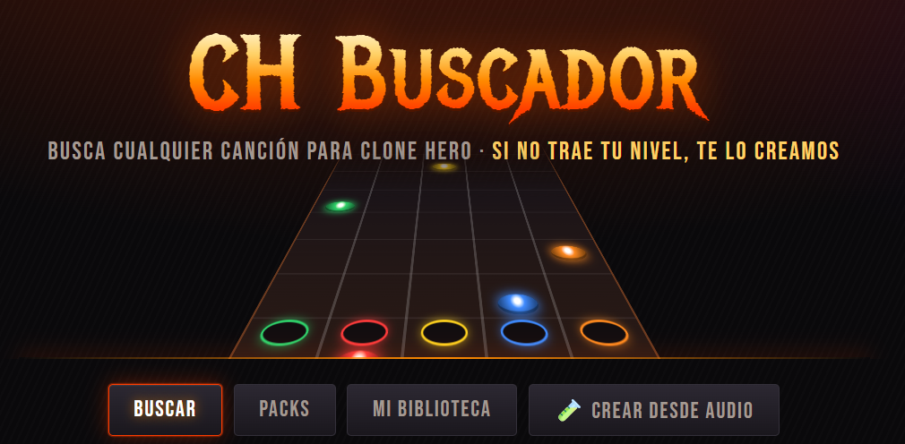

# 🎸 CH Buscador



**▶ Úsala aquí: https://alejandrocastellanos.github.io/song-finder-clone-hero/**

Busca canciones para **Clone Hero** y, si no traen la dificultad que necesitas, **te la genera automáticamente**.

Muchas canciones hechas por la comunidad solo traen el nivel **Expert**. CH Buscador crea **Fácil, Medio y Difícil** a partir del Expert, para que cualquiera pueda tocarlas.

## Tres formas de usarlo

### 1. App web (la más fácil, no necesita instalar nada)

1. Abre `index.html` en **Chrome** o **Edge** (o la página publicada, ver abajo).
2. Pulsa **Elegir carpeta Songs** y selecciona tu carpeta de canciones de Clone Hero.
3. Marca las dificultades que necesitas (Fácil, Medio, Difícil).
4. Busca por **canción o artista** o por **género** y elige cuántos resultados quieres.
5. Pulsa **Descargar** en cada canción, o marca varias y pulsa **Descargar seleccionadas**.
6. En Clone Hero: **Settings → General → Scan Songs**.

Cada nivel se muestra como una gema de color (🟢 Fácil, 🟡 Medio, 🔴 Difícil, 🟠 Experto):

| Gema | Significado |
|---|---|
| Rellena y brillante | El nivel viene en el chart original |
| Borde punteado | Se crea automáticamente al descargar |
| Apagada | No se crea |

Las llamas 🔥 (de 0 a 6) indican qué tan intensa es la canción.

**Más cosas que puedes hacer:**

- **▶ Ver**: vista previa jugable. Una autopista de notas como la de Clone Hero toca la canción con su audio, y puedes cambiar de instrumento y de nivel (los niveles creados dicen *creado*). Así compruebas cómo quedan antes de descargar.
- **Packs**: listas armadas (Rock en Español, Rock Latino, Clásicos de Guitar Hero y Rock Band, Imprescindibles, Rancheras y Regional) que se descargan con un clic.
- **Compartir**: cada búsqueda y cada pack tiene su enlace (por ejemplo `?pack=rock-latino` o `?q=Metallica`).
- **Mi biblioteca**: *Ver estadísticas* revisa tu carpeta sin cambiar nada (cuántas canciones tienen todos los niveles, artistas, géneros). *Revisar y arreglar* les crea los niveles que falten y guarda una copia `.sng.original` de cada canción que modifica.
- **Ajustar niveles creados**: en la vista previa hay perillas de densidad (menos/más notas), acordes sí/no y naranja en Medio. Se aplican a todas tus descargas. Los niveles originales nunca se tocan.
- **✏️ Editar en Moonscraper**: baja la canción como carpeta `.zip` (song.ini + chart + audio) para corregirla nota por nota en Moonscraper Chart Editor.
- **🧪 Crear desde audio** (experimental): sube un MP3/OGG/WAV de una canción que nadie ha chartiado y la app arma un chart jugable con los 4 niveles. Detecta bien el pulso, pero las notas siguen el ritmo de toda la canción (no solo la guitarra): en pruebas contra charts hechos a mano, encuentra la gran mayoría de las notas reales pero también agrega otras. Todo se procesa en tu PC.
- **Sonido**: botón arriba a la derecha para activar rasgueos de guitarra al buscar y al terminar descargas.
- **🎤 Letra**: si la canción no la trae, se busca en [LRCLIB](https://lrclib.net) y se agrega con tiempos, solo en tu copia. LRCLIB sincroniza por línea, así que los tiempos de cada palabra son aproximados. Si no hay una versión con la misma duración, no se agrega, para no quedar desfasada.
- **🥁 Batería**: si la canción no trae batería, se crea desde el audio con sus 4 niveles. Sale mejor si la canción trae su pista de batería separada. Es un borrador automático: el bombo suele salir bien; el redoblante y los platillos, menos.
- **🖼 Fondo**: elige una imagen (JPG, PNG) o un video (MP4, WEBM, AVI, OGV, MPEG) y queda dentro de cada canción que guardes. Para verlo, activa los fondos de canción en las opciones de Clone Hero.
- **Packs por género y por artista**: Metal, Punk, Grunge, Pop, Metallica, Queen, Soda Stereo y muchos más.
- **Instalarla**: publicada en internet (HTTPS), Chrome y Edge ofrecen instalarla como app con su propio ícono.

> **Firefox y Safari** no tienen la función de elegir carpeta: una canción baja a Descargas, varias bajan en archivos `.zip`, y las pasas a tu carpeta Songs. **Mi biblioteca** también funciona: lee tu carpeta y te devuelve las canciones arregladas en `.zip`. **Brave** la trae apagada: se activa en `brave://flags/#file-system-access-api`.

### 2. Con tu agente (Claude Code)

Abre esta carpeta en Claude Code y pide algo como:

> quiero canciones de Soda Stereo

El agente te pregunta paso a paso: qué buscar (artista, género o canción), qué niveles necesitas, cuántos resultados, cuáles descargar y en qué carpeta. Necesita **Node.js 18 o superior**.

### 3. Línea de comandos

```bash
node cli/chb.js buscar --artista "Soda Stereo" --niveles facil,medio,dificil --cantidad 20
```

```bash
node cli/chb.js descargar --numeros 1,3,5-8 --carpeta "C:\Users\TU_USUARIO\Documents\Clone Hero\Songs"
```

```bash
node cli/chb.js arreglar --carpeta "C:\Users\TU_USUARIO\Documents\Clone Hero\Songs"
```

También hay `--genero`, `--texto`, `--solo-originales`, `--todas`, `--solo-guitarra` y `--json`.

## Publicarla para que otros la usen

Como es una página estática, puedes publicarla gratis con **GitHub Pages**:

1. Sube esta carpeta a un repositorio de GitHub.
2. En el repositorio ve a **Settings → Pages**, elige la rama `main` y la carpeta `/ (root)`.
3. En un minuto tendrás un enlace tipo `https://alejandrocastellanos.github.io/song-finder-clone-hero/` para compartir.

## Cómo se generan las dificultades

| Nivel | Qué hace con el Expert |
|---|---|
| **Difícil** | Quita notas más rápidas que una semicorchea y deja acordes de máximo 2 notas |
| **Medio** | Máximo una nota por corchea, acordes de 2 notas y sin el botón naranja |
| **Fácil** | Máximo una nota por tiempo, sin acordes, solo verde, rojo y amarillo |

Se conservan el Star Power y los solos. En batería se prioriza tocar los tambores sobre el bombo. Funciona con charts `.chart` y `.mid`, para guitarra, bajo, rítmica, teclado y batería.

Son reducciones automáticas: se pueden jugar, pero no son tan pulidas como las hechas a mano por un charter.

## Créditos

- Canciones y buscador: [Chorus Encore](https://www.enchor.us), de la comunidad de Clone Hero. Los charts son obra de sus autores (se muestra el nombre de cada uno).
- Formato `.sng`: [SngFileFormat](https://github.com/mdsitton/SngFileFormat).

Este proyecto no está afiliado a Clone Hero ni a Chorus Encore. Úsalo con moderación: descarga lo que vayas a tocar.

## Estadísticas públicas (Supabase)

El contador de descargas, "Lo más descargado esta semana" y las valoraciones se guardan en Supabase (`community.js`). La estructura está en `supabase/schema.sql`. La web usa solo la clave pública: las tablas no se pueden leer ni cambiar directamente, únicamente a través de esas funciones. Solo cuenta lo que pasa en la página publicada, una vez por canción, navegador y día. No se guardan datos personales, y como no hay cuentas de usuario estas cifras son orientativas.
