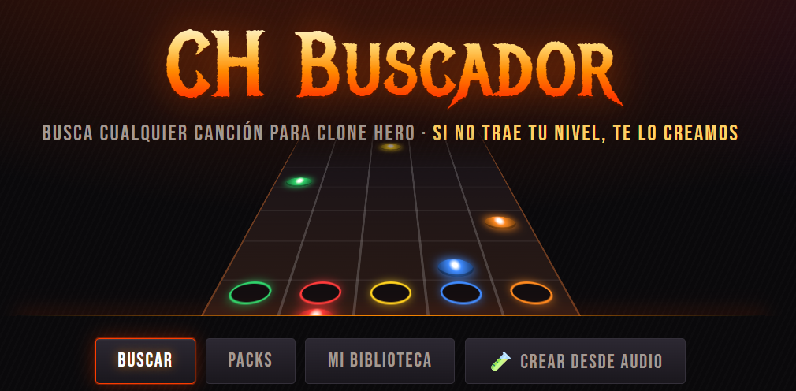

# 🎸 CH Buscador



**▶ Úsala aquí: https://alejandrocastellanos.github.io/song-finder-clone-hero/**

Busca canciones para **Clone Hero** y, si no traen la dificultad que necesitas, **te la genera automáticamente**.

Muchas canciones hechas por la comunidad solo traen el nivel **Expert**. CH Buscador crea **Fácil, Medio y Difícil** a partir del Expert, para que cualquiera pueda tocarlas.

## Tres formas de usarlo

### 1. App web (la más fácil, no necesita instalar nada)

1. Abre `index.html` en **Chrome** o **Edge** (o la página publicada, ver abajo).
2. Pulsa **Elegir carpeta Songs** y selecciona tu carpeta de canciones de Clone Hero.
3. Marca las dificultades que necesitas (Fácil, Medio, Difícil).
4. Busca por **canción o artista** o por **género** y elige cuántos resultados quieres.
5. Pulsa **Descargar** en cada canción, o marca varias y pulsa **Descargar seleccionadas**.
6. En Clone Hero: **Settings → General → Scan Songs**.

Cada nivel se muestra como una gema de color (🟢 Fácil, 🟡 Medio, 🔴 Difícil, 🟠 Experto):

| Gema | Significado |
|---|---|
| Rellena y brillante | El nivel viene en el chart original |
| Borde punteado | Se crea automáticamente al descargar |
| Apagada | No se crea |

Las llamas 🔥 (de 0 a 6) indican qué tan intensa es la canción.

**Más cosas que puedes hacer:**

- **▶ Ver**: vista previa jugable. Una autopista de notas como la de Clone Hero toca la canción con su audio, y puedes cambiar de instrumento y de nivel (los niveles creados dicen *creado*). Así compruebas cómo quedan antes de descargar.
- **Packs**: listas armadas (Rock en Español, Rock Español Clásico, Rock Latino, Clásicos de Guitar Hero y Rock Band, Imprescindibles, Rancheras y Regional) que se descargan con un clic.
- **Compartir**: cada búsqueda y cada pack tiene su enlace (por ejemplo `?pack=rock-latino` o `?q=Metallica`).
- **Mi biblioteca**: funciona con archivos `.sng` y con canciones **en carpeta** (`song.ini` + `notes.chart` o `notes.mid`, las que se editan en Moonscraper). *Ver estadísticas* revisa tu carpeta sin cambiar nada (cuántas canciones tienen todos los niveles, artistas, géneros). *Revisar y arreglar* les crea los niveles que falten (y la letra o la batería, si las marcaste) y guarda una copia `.original` de cada archivo que modifica.
- **📁 Guardar como carpeta**: en vez de un `.sng`, cada canción baja como carpeta (`song.ini` + chart + audio). Úsalo si tu Clone Hero es anterior a la 1.1 (esas versiones no leen `.sng`) o si vas a editarlas en Moonscraper.
- **Ajustar niveles creados**: en la vista previa hay perillas de densidad (menos/más notas), acordes sí/no y naranja en Medio. Se aplican a todas tus descargas. Los niveles originales nunca se tocan.
- **✏️ Editar en Moonscraper**: baja la canción como carpeta `.zip` (song.ini + chart + audio) para corregirla nota por nota en Moonscraper Chart Editor.
- **🧪 Crear desde audio** (experimental): sube un MP3/OGG/WAV de una canción que nadie ha chartiado y la app arma un chart jugable con los 4 niveles. Agrupa los compases que suenan parecido y los chartea juntos, así un riff que se repite sale con los mismos botones cada vez, como en un chart hecho a mano. Las notas siguen toda la canción (no solo la guitarra), así que no queda igual a uno de un charter (ver *Qué tan bien funciona*). Si subes WAV, M4A o FLAC, el audio se convierte a Opus, el formato que recomiendan las guías de charts (en Chrome y Edge; si el navegador no puede, queda en WAV y la app te avisa). Todo se procesa en tu PC.
- **🎼 Solo mapa de tempo**: en *Crear desde audio*, te da la carpeta con el audio y el pulso ya marcado, para poner tú las notas en Moonscraper.
- **Sonido**: botón arriba a la derecha para activar rasgueos de guitarra al buscar y al terminar descargas.
- **🎤 Letra**: si la canción no la trae, se busca en [LRCLIB](https://lrclib.net) y se agrega con tiempos, solo en tu copia. LRCLIB sincroniza por línea, así que los tiempos de cada palabra son aproximados. Si no hay una versión con la misma duración, no se agrega, para no quedar desfasada.
- **🥁 Batería**: si la canción no trae batería, se crea desde el audio con sus 4 niveles. Marca *Crear la batería* y se crea al descargar (o en *Mi biblioteca → Revisar y arreglar*). Usa el pulso de la propia canción y separa lo percusivo del resto del sonido. Sale mejor si la canción trae su pista de batería separada. Es un borrador automático: el bombo y los platillos salen bien; el redoblante a veces aparece de más.
- **🖼 Fondo**: elige una imagen (JPG, PNG) o un video (MP4, WEBM, AVI, OGV, MPEG) y queda dentro de cada canción que guardes. Para verlo, activa los fondos de canción en las opciones de Clone Hero.
- **Packs por género y por artista**: Metal, Punk, Grunge, Pop, Metallica, Queen, Soda Stereo y muchos más.
- **Instalarla**: publicada en internet (HTTPS), Chrome y Edge ofrecen instalarla como app con su propio ícono.

> **Firefox y Safari** no tienen la función de elegir carpeta: una canción baja a Descargas, varias bajan en archivos `.zip`, y las pasas a tu carpeta Songs. **Mi biblioteca** también funciona: lee tu carpeta y te devuelve las canciones arregladas en `.zip`. **Brave** la trae apagada: se activa en `brave://flags/#file-system-access-api`.

### 2. Con tu agente (Claude Code)

Abre esta carpeta en Claude Code y pide algo como:

> quiero canciones de Soda Stereo

El agente te pregunta paso a paso: qué buscar (artista, género o canción), qué niveles necesitas, cuántos resultados, cuáles descargar y en qué carpeta. Necesita **Node.js 18 o superior**.

### 3. Línea de comandos

```bash
node cli/chb.js buscar --artista "Soda Stereo" --niveles facil,medio,dificil --cantidad 20
```

```bash
node cli/chb.js descargar --numeros 1,3,5-8 --carpeta "C:\Users\TU_USUARIO\Documents\Clone Hero\Songs"
```

```bash
node cli/chb.js arreglar --carpeta "C:\Users\TU_USUARIO\Documents\Clone Hero\Songs"
```

También hay `--genero`, `--texto`, `--solo-originales`, `--todas`, `--solo-guitarra` y `--json`.

## Publicarla para que otros la usen

Como es una página estática, puedes publicarla gratis con **GitHub Pages**:

1. Sube esta carpeta a un repositorio de GitHub.
2. En el repositorio ve a **Settings → Pages**, elige la rama `main` y la carpeta `/ (root)`.
3. En un minuto tendrás un enlace tipo `https://alejandrocastellanos.github.io/song-finder-clone-hero/` para compartir.

## Qué tan bien funciona *Crear desde audio*

Se midió contra los charts oficiales de Harmonix (Rock Band) de 12 canciones (Blitzkrieg Bop, Learn to Fly, Message in a Bottle, Enter Sandman, Seven Nation Army, Mr. Brightside, Livin' on a Prayer, Black Hole Sun, Smells Like Teen Spirit, Hysteria, Eye of the Tiger, Say It Ain't So). Se ajustó con 8 y se comprobó con las otras 4. Resultados en esas 4:

| | Antes | Ahora |
|---|---|---|
| Un riff repetido sale con los mismos botones | 0% | 34% |
| Un riff repetido sale con el mismo ritmo | 12% | 45% |
| Pulso correcto (a 70 ms) | 68% | 80% |
| Notas que coinciden con las del chart (F) | 0.64 | 0.65 |
| Batería: bombo / redoblante / platillos (F) | 0.62 / 0.31 / 0.69 | 0.74 / 0.58 / 0.81 |

Lo que todavía no se logra desde la mezcla completa: saber si cada nota sube o baja de botón como en el chart (acierta ~40%, el azar es 33%), dónde van los acordes y cuáles son notas largas. Probar con la pista de guitarra aislada no mejoró esos números, así que separar instrumentos con IA no es, por ahora, la solución.

## Cómo se generan las dificultades

| Nivel | Qué hace con el Expert |
|---|---|
| **Difícil** | Notas a 0.19 s o más entre sí, acordes de máximo 2 notas |
| **Medio** | Notas a 0.3 s o más, sin acordes (queda la nota más baja) y sin el botón naranja |
| **Fácil** | Notas a 0.51 s o más, sin acordes (queda la nota más baja), solo verde, rojo y amarillo |
| **Batería** | Difícil y Medio dejan hasta 2 golpes a la vez (bombo + platillo se queda). Fácil quita el bombo cuando suena con un tambor o platillo |

Las reglas se ajustaron midiendo contra los Difícil, Medio y Fácil hechos a mano por Harmonix en 30 canciones de Rock Band (10 de ellas solo para comprobar). En esas 10:

| | Antes | Ahora |
|---|---|---|
| Guitarra Difícil / Medio / Fácil (F, coincidencia de notas) | 0.72 / 0.70 / 0.57 | 0.88 / 0.83 / 0.74 |
| Bajo Difícil / Medio / Fácil (F) | 0.73 / 0.65 / 0.58 | 0.87 / 0.84 / 0.72 |
| Batería Difícil / Medio / Fácil (F) | 0.78 / 0.75 / 0.55 | 0.93 / 0.94 / 0.71 |
| Batería Medio: golpes correctos | 15% | 74% |
| Guitarra Fácil: botón correcto | 47% | 62% |

Ahora los niveles tienen casi la misma cantidad de notas que los oficiales (antes, ~40% menos). Si los prefieres más fáciles, en las perillas elige **menos notas**: queda muy parecido a como era antes.

Se conservan el Star Power y los solos. Funciona con charts `.chart` y `.mid`, para guitarra, bajo, rítmica, teclado y batería.

Son reducciones automáticas: se pueden jugar, pero no son tan pulidas como las hechas a mano por un charter.

Para comprobar que un cambio no empeora los niveles: `node cli/prueba-calidad.js` (necesita internet). Descarga esas 30 canciones, les vuelve a crear los niveles y avisa si alguna cifra baja del mínimo.

## Créditos

- Canciones y buscador: [Chorus Encore](https://www.enchor.us), de la comunidad de Clone Hero. Los charts son obra de sus autores (se muestra el nombre de cada uno).
- Formato `.sng`: [SngFileFormat](https://github.com/mdsitton/SngFileFormat).

Este proyecto no está afiliado a Clone Hero ni a Chorus Encore. Úsalo con moderación: descarga lo que vayas a tocar.

## Estadísticas públicas (Supabase)

El contador de descargas, "Lo más descargado" (por semana e histórico) y las valoraciones se guardan en Supabase (`community.js`). La estructura está en `supabase/schema.sql`. La web usa solo la clave pública: las tablas no se pueden leer ni cambiar directamente, únicamente a través de esas funciones. Solo cuenta lo que pasa en la página publicada, una vez por canción, navegador y día. No se guardan datos personales, y como no hay cuentas de usuario estas cifras son orientativas.
